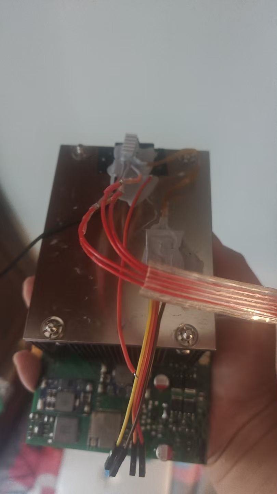
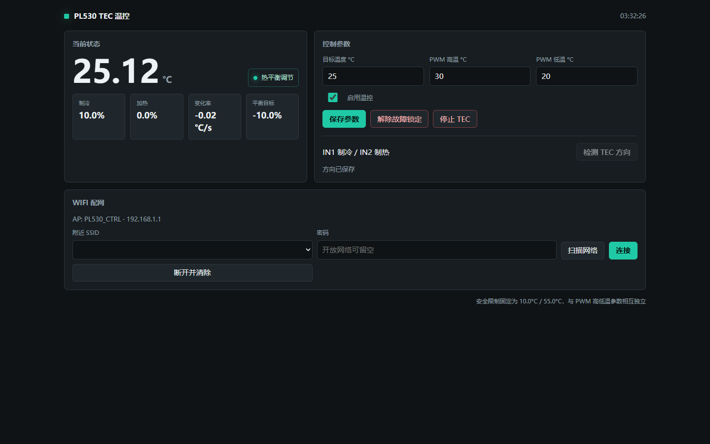

# PL530 TEC 温控

基于 ESP32-S3-WROOM-1-N8R8 的 TEC 温控板，用 TMP117 测温、DRV8701P 配外置 NMOS H 桥驱动，带一个中文网页控制界面。

原版样机已经跑过连续 30 分钟烤机，整体运行很稳，激光全程保持单纵模没有跳模，输出功率也稳定。仓库里保留了原版固件（“非线性接近 + 热平衡修正”算法）、一套独立维护的精密 PID 实验版固件、嘉立创 EDA 专业版 PCB 工程，以及完整的中文文档和本地测试脚本。

## 硬件与基本配置

| 项目 | 配置 |
|---|---|
| 主控模组 | ESP32-S3-WROOM-1-N8R8（8 MB Flash、8 MB 八线 PSRAM） |
| 温度传感器 | TMP117，默认 I2C 地址 `0x48` |
| H 桥驱动 | DRV8701PRGER（PWM 接口版 DRV8701P），外置四颗 NMOS |
| PWM 输出 | 1 kHz、10 位（精密 PID 实验版提升至 14 位） |
| I2C 总线 | 约 2 kHz 软件 I2C，自动试探 GPIO8/9 与 GPIO9/8 线序 |
| 系统供电 | DRV 的 `VM` 接 12 V；TEC H 桥走独立低压电源并共地，别把 TEC 接到 12 V |
| 恒压与调压 | MINI560 降压模块，将反馈分压的一颗固定电阻换成电位器手动调压 |
| TEC 电源 | 独立 MINI560 DC-DC，按 TEC 规格、电流与散热设为 3.3 V 或 5 V |
| 恒流方案 | 基于 LM2596 的恒流模块方案，后续计划补强滤波与旁路电容 |
| 网页界面 | 默认热点 `PL530_CTRL`，密码 `pl530tecpass`，地址 `http://192.168.1.1` |
| 温度硬限制 | 10~55 °C（独立于网页设定的 PWM 高低温区间） |
| 方向检测 | 实机 PWM 上限 30%，每向输出 4 秒，中间停机 18 秒回稳 |
| 调试入口 | 普通构建默认关闭，需要台架手调时再编译调试构建 |

本工程不兼容早期 AT8236、BMP280 或 ESP32-C3 方案，别把 S3 固件刷到 C3 上。MINI560 改电位器和 LM2596 补电容的做法见 [硬件与实测](docs/硬件与风险.md#恒压与恒流模块)。

## 样机实拍

样机热端压了一块服务器散热器，更多装配近照和干涉条纹测试照片见 [样机实拍与散热](docs/硬件与风险.md#样机实拍与散热)。



## 网页界面



## 上手流程

1. 对照 [硬件与实测](docs/硬件与风险.md) 核对接线、独立供电、散热器压紧情况和探头位置，并在功率供电前串一个物理开关方便随时断电。
2. 按 [编译与烧录](docs/编译与烧录.md) 编译普通固件，用外置 3.3 V UART 下载器烧写进模组。
3. 连上热点 `PL530_CTRL` 并打开 `http://192.168.1.1`（正式用之前记得去 `include/config.h` 改掉默认 AP 密码）。
4. 确认实时温度有效。首次装机、改过 TEC 接线或挪过探头位置后，在网页上跑一次方向检测。
5. 检测成功后 TEC 仍保持停用，设好目标温度和 PWM 高低温范围再点启用。

板子每次上电默认停用 TEC；如果运行中遭遇采样超时，等有效温度恢复后固件会自动恢复超时前的启停状态。详细保护逻辑和调试模式行为见 [温控与接口](docs/温控与接口.md) 和 [调试接口](docs/调试接口.md)，实测和主机验证情况见 [实测表现](docs/硬件与风险.md#实测表现) 与 [发布验证](docs/发布验证.md)。

## 仓库内容

| 路径 | 说明 |
|---|---|
| `src/`、`include/` | 原版固件源码、中文网页与 NVS 配置存储 |
| `hardware/PL530.epro2` | 原始 PCB 工程，用嘉立创 EDA / EasyEDA 专业版打开 |
| `docs/` | 硬件接线、编译烧录、接口协议、调试指令和验证文档 |
| `tests/`、`tools/test.mjs` | 控制器、传感器、存储、接口及 Playwright 网页回归测试 |
| `.github/workflows/verify.yml` | CI 工作流：跑主机与网页测试，并编译原版普通、调试与精密 PID 三套固件 |
| `firmware/precision_pid/` | 独立精密 PID 实验版工程（仅过软件测试，未上板实测） |

## 精密 PID 实验版

另外在 `firmware/precision_pid/` 放了一套独立的 [精密 PID 实验工程](firmware/precision_pid/README.md)，原版源码和根目录构建配置一字未动。**新版代码目前只跑过仿真和主机单元测试，还没上板实测；±10 mK 是后续实机整定目标，别把原版的 30 分钟烤机结果套到新版上。**

新版改用按真实采样间隔计算的双向 PID、测量微分与抗积分饱和，搭配 TMP117 八次硬件平均、14 位 PWM 和原始温度统计。只要还没追到目标温度就会持续积分纠偏，不再把“高于目标但温升率为零”当成稳态达标；停机状态下可以直接在网页里调整 PID 参数。

```powershell
pio run -d firmware/precision_pid -e precision_pid -j 1
```

原版依旧在根目录用 `pio run -e pl530_tec` 编译。新版 NVS 参数空间与原版互相隔离，切过去首次烧录后记得重新做一次方向检测。

## 文档

- [硬件与实测](docs/硬件与风险.md)
- [编译与烧录](docs/编译与烧录.md)
- [温控与接口](docs/温控与接口.md)
- [调试接口](docs/调试接口.md)
- [整理记录](docs/整理记录.md)
- [发布验证](docs/发布验证.md)
- [贡献说明](CONTRIBUTING.md)

## 开源协议

Copyright (c) 2026 whoiswei114514.

项目原创代码、文档和硬件设计基于 [GNU GPLv3（GPL-3.0-only）](LICENSE) 开源。依赖库及 PCB 工程内嵌的第三方器件封装与模型适用各自原有协议。

## 致谢

开发与排查过程中大量用到了 GPT 和 Gemini，感谢 OpenAI ChatGPT 与 Google Gemini 在代码编写、排障、调试及文档整理上的协助。

所用 GPT 模型接口由 [AgentRouter](https://agentrouter.org/register?aff=6c4F) 和 [AnyRouter](https://anyrouter.top/register?aff=l3yU) 提供（这两个渠道注册链接带有推荐 aff 参数）。
