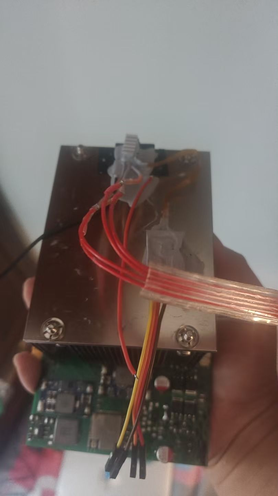
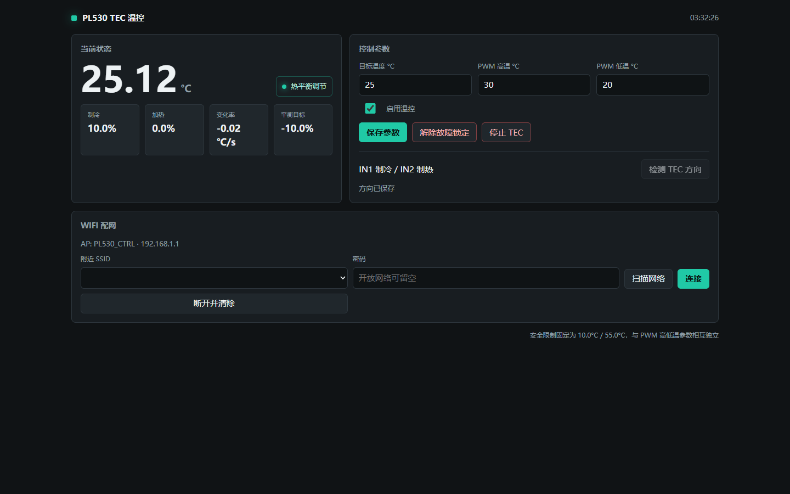

# PL530 TEC 温控

基于 ESP32-S3-WROOM-1-N8R8 的 TEC 温控项目，使用 TMP117 测温、DRV8701P 与外置 MOS H 桥驱动，提供中文网页控制界面。

> **硬件实测可运行，但不是量产或安全认证设计。电路包含 AI 生成和自动布线，可能存在走线、间距、接地或焊接问题。复刻前必须自行检查。PCB 工程仅兼容 LCEDA/嘉立创EDA/EasyEDA，不提供 KiCad、Altium 等格式。**

本仓库整理自原项目、Codex 的设计与烧录调试记录，以及 Google Antigravity 的后续修改。保留现有温控算法，没有整体改写为传统 PID；清理了临时烧录脚本、过时接线资料、旧固件和本机路径。仓库内说明文档均为中文。

## 当前版本

| 项目 | 配置 |
|---|---|
| 模组 | ESP32-S3-WROOM-1-N8R8，8 MB Flash、8 MB 八线 PSRAM |
| 温度传感器 | TMP117，默认地址 `0x48` |
| 驱动 | DRV8701PRGER，即 PWM 接口版本 DRV8701P，外置四颗 NMOS |
| PWM | 1 kHz、10 位；不是早期设计中的 30 kHz |
| I2C | 约 2 kHz 软件 I2C，自动尝试 GPIO8/9 和 GPIO9/8 |
| 系统供电 | DRV 的 VM 接 12 V；TEC H 桥使用独立低压电源，不能把 TEC 接到 12 V |
| 恒压模块 | MINI560；通过将反馈分压中的一只固定电阻改为电位器实现调压 |
| TEC 电源 | 独立 MINI560 DC-DC，可选择 3.3 V 或 5 V，需核对 TEC 额定值、实际电流与散热 |
| 恒流模块 | 基于 LM2596 的恒流模块方案，电容补强仍需完善 |
| 网页 | AP 默认名称 `PL530_CTRL`，密码 `pl530tecpass`，地址 `http://192.168.1.1` |
| 硬限制 | 10~55 °C，独立于网页可设置的 PWM 高低温 |
| 方向检测 | 实机 PWM 上限 30%，每向 4 秒，中间停机 18 秒 |
| 调试入口 | 保留，普通构建关闭，调试构建显式启用 |

不兼容早期 AT8236、BMP280 或 ESP32-C3 方案。不要把 S3 固件烧到 C3。

MINI560 的电位器改装、固定方式与 LM2596 电容补强说明见 [硬件与风险](docs/硬件与风险.md#恒压与恒流模块)。硬件部分没有器件或模块赞助商，因此不提供购买链接、店铺或代购渠道。

## 样机实拍

样机使用 **服务器散热器** 作为散热组件。没有散热器或其他硬件赞助商，因此不提供购买链接或店铺推荐。三张实拍照片及装配说明见 [样机实拍与散热](docs/硬件与风险.md#样机实拍与散热)。

## 网页界面

## 开始使用

1. 先阅读 [硬件与风险](docs/硬件与风险.md)，检查电源、焊接、散热器、探头与硬件断电装置。
2. 按 [编译与烧录](docs/编译与烧录.md) 编译普通固件，通过外置 3.3 V UART 下载器烧录。
3. 连接 `PL530_CTRL`，打开 `http://192.168.1.1`。首次部署前在 `include/config.h` 修改默认 AP 密码。
4. 确认实时温度有效。首次安装或改变 TEC 接线、探头位置后，显式执行方向检测。
5. 检测成功后仍保持停用，再设置目标温度、PWM 高低温并启用控制。

启动不自动开启 TEC。方向未知时禁止正常温控；不能为了绕过检测失败而随意指定方向。

**注意：保留的现场固件会在有效温度恢复后自动解除采样超时，并可能恢复之前启用的控制。调试固件的强制唤醒还会绕过部分保护。详情见 [温控与接口](docs/温控与接口.md) 和 [调试接口](docs/调试接口.md)。网页停止不是硬件急停。**

## 项目内容

| 路径 | 内容 |
|---|---|
| `src/`、`include/` | 固件、中文网页、传感器与配置存储 |
| `hardware/PL530.epro2` | 用户指定的原始 PCB 工程，未经改写 |
| `docs/` | 中文接线、编译、接口、调试、历史和验证说明 |
| `tests/`、`tools/test.mjs` | 控制器、传感器、存储、接口与网页回归测试 |
| `.github/workflows/verify.yml` | 自动编译普通与调试固件，并执行主机测试 |

## 验证边界

历史实机记录包含成功烧录、TMP117 读温度和 TEC 降温；也包含单方向触发驱动器故障及电荷泵电容虚焊的记录。**“实测可运行”不等于所有方向、保护、负载和长期稳定性均已通过验收。**

本次发布重新执行主机测试与两套固件编译，不重新烧录、不接通 TEC、不宣称新版本已完成实机验证。实际结果与限制见 [发布验证](docs/发布验证.md)。

## 文档

- [硬件与风险](docs/硬件与风险.md)
- [编译与烧录](docs/编译与烧录.md)
- [温控与接口](docs/温控与接口.md)
- [调试接口](docs/调试接口.md)
- [整理记录](docs/整理记录.md)
- [发布验证](docs/发布验证.md)
- [贡献说明](CONTRIBUTING.md)

## 许可

项目原创代码、文档和设计内容使用 [MIT 许可证](LICENSE)，许可正文为中文。依赖框架、工具及 PCB 内嵌的第三方器件库、封装、模型仍适用各自许可证；本仓库许可不替代其条款。项目按现状提供，没有可制造性、电气安全或适用性保证。

## 致谢

本项目使用 GPT 和 Gemini 协助开发与调试，感谢 OpenAI ChatGPT 和 Google Gemini 对本项目代码开发、问题排查、调试及文档整理的贡献。

项目使用的 GPT 模型服务由 [AgentRouter](https://agentrouter.org/register?aff=6c4F) 和 [AnyRouter](https://anyrouter.top/register?aff=l3yU) 提供，感谢两个渠道的支持。以上渠道链接含推荐参数。
