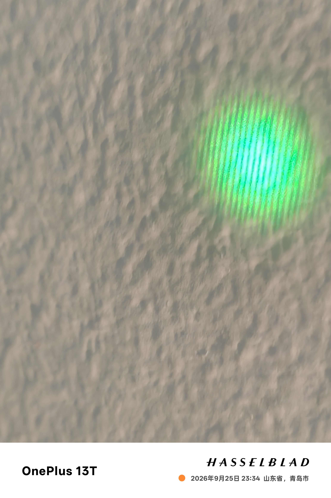

# 硬件与实测

## 硬件说明

本项目使用 ESP32-S3-WROOM-1-N8R8、TMP117 和 DRV8701P 外置 H 桥。PCB 工程位于 `hardware/PL530.epro2`，下表列出固件使用的接口，来源于 Kit_2/PCB3_2 记录。接线时请对照实物插座和工程版本。

| 信号 | ESP32-S3 GPIO | 模组物理引脚 | 对端 |
|---|---|---|---|
| PWM IN1 | GPIO4 | 4 | DRV8701P 引脚 15 |
| PWM IN2 | GPIO5 | 5 | DRV8701P 引脚 14 |
| nSLEEP | GPIO6 | 6 | DRV8701P 引脚 13 |
| nFAULT | GPIO7 | 7 | DRV8701P 引脚 9 |
| SDA | GPIO8 | 12 | TMP117 SDA |
| SCL | GPIO9 | 17 | TMP117 SCL |
| UART RX | GPIO44 | 36 | 下载器 TXD |
| UART TX | GPIO43 | 37 | 下载器 RXD |
| BOOT | GPIO0 | 27 | BOOT 按键 |
| EN | 非 GPIO | 3 | 复位按键 |

模组物理引脚号与 GPIO 号不同。固件可探测 GPIO8/9 的 SDA、SCL 顺序；电源、地、地址与上拉按实际硬件配置。

TMP117 四针接口在原项目中按 `VCC / SCL / SDA / GND` 排列，使用 3.3 V、地址 `0x48`。接线前确认插座方向与针序，并检查主板外部 I2C 上拉是否装配。

## 电源与功率回路

DRV8701 的 `VM=12V_SYS`，独立低压 TEC 母线接高侧 MOS 漏极，低侧经检流电阻回地。**DRV 使用 12 V，TEC 使用独立低压电源，两路共地；不要将 TEC 接到 12 V。**

TEC 原始规格为 04903、额定 5 V/3 A。独立 DC-DC 可选择 **3.3 V 或 5 V**，按 TEC 规格、工作电流、散热条件和电源带载能力配置。更换电压后重新检查热响应并执行方向检测。

母线电压由 DC-DC 调节，使用万用表确认。固件不读取或设置该电压，串口中的历史电压文字不是测量值。

分供电设计需核对 `IDRIVE` 与芯片自身 `AVDD` 的连接。DRV 的 `AVDD`、`DVDD` 是内部输出，不与外部电源并接；电荷泵电容按指定节点跨接。

`SO` 在原板上仅接测试点，未接 ESP32 ADC，因此网页不显示电流，固件也不提供电流闭环。电流监测与限流由外部仪表、电源或保护器件完成。

## 恒压与恒流模块

### MINI560 恒压与调压

恒压支路使用 **MINI560 降压模块**。样机将反馈分压网络中的一只固定电阻替换为合适阻值范围的电位器，手动调节输出电压。

样机使用双面胶将电位器固定在模块电感顶部。安装时做好引脚与接线绝缘，选用耐温胶材，并留出散热空间。

不同批次 MINI560 的反馈网络与布局可能不同，电阻位号和电位器阻值按实际模块选择。调节前先断开负载，设定并测量输出电压后再接入电路，避免输出过压。

TEC 的 MINI560 模块可设置为 3.3 V 或 5 V，供给 **TEC H 桥的独立低压母线**，与 DRV8701 的 12 V VM、ESP32 的 3.3 V 逻辑电源轨分开。

### LM2596 恒流方案与电容

恒流支路使用 **基于 LM2596 的恒流模块方案**，通过模块上的电流采样与反馈电路实现恒流，选型时应确认模块具备该功能。

当前样机保留模块原有电容，受采购成本影响，额外滤波与就近旁路电容尚未全部补齐，计划按实际负载进一步完善。

电容选型需考虑耐压、纹波电流、ESR、布局与环路稳定性，并检查输出纹波及负载响应。LM2596 输出电容应满足其 ESR 要求，可参考 TI《LM2596 数据手册》（SNVS124G）。

### 购买渠道

本项目没有硬件赞助，不提供购买链接、店铺推荐或代购服务。文中型号用于说明样机方案。

## 样机实拍与散热

样机使用 **服务器散热器** 作为散热组件，具体型号可按安装空间、热负载与风道选择。

以下照片由项目作者提供，保留原图画面，展示样机装配与干涉条纹测试现场。

### 温控样机整体

整体照片展示服务器散热器、控制板与外部接线的装配关系。

### 服务器散热器装配

近照展示散热器、固定件与周边接线，供装配时参考。

### 干涉条纹测试

照片记录的是干涉条纹测试。样机的烤机与激光输出表现见下方实测记录。

## 实测表现

根据项目作者补充的实测结果，原版样机已完成连续 **30 分钟烤机测试**，实测表现如下：

| 测试项 | 结果 |
|---|---|
| 连续运行 | 30 分钟烤机，运行稳定 |
| 纵模状态 | 维持单纵模，测试期间未出现跳模 |
| 输出功率 | 测试期间功率稳定 |

早期调试记录还包含成功烧录、TMP117 读温度，以及反向 50% PWM 测试中温度由约 31.45 °C 降至 30.92 °C 的过程。软件回归测试与固件编译结果见 [发布验证](发布验证.md)。

## 装配与操作要点

- **工程检查：** 电路设计包含 AI 辅助生成与自动布线。复刻时核对网表、功率回路、间距、载流能力与接地，并执行 ERC/DRC。
- **供电与散热：** 首次上电使用限流电源，检查电压、工作电流、MOS 栅极电压和温升，确认散热器接触与固定可靠。
- **探头安装：** TMP117 测量安装点温度，安装位置应贴近被控对象。
- **停机与调试：** 预留直接切断功率的硬件开关。强制唤醒会绕过部分保护，使用方法见 [调试接口](调试接口.md)。

### 历史检查与排障记录

历史工程检查记录包含 16 项模块槽距问题和 1 项原生网表差异汇总提示，本次文档整理沿用原工程，未重跑 ERC/DRC。早期实物调试中，电荷泵 C2 曾虚焊，补焊后 VCP 约为 21.5 V；另有正向触发 nFAULT 的记录。若复刻时出现 nFAULT，应停机检查焊接、供电与驱动回路，再恢复测试。
