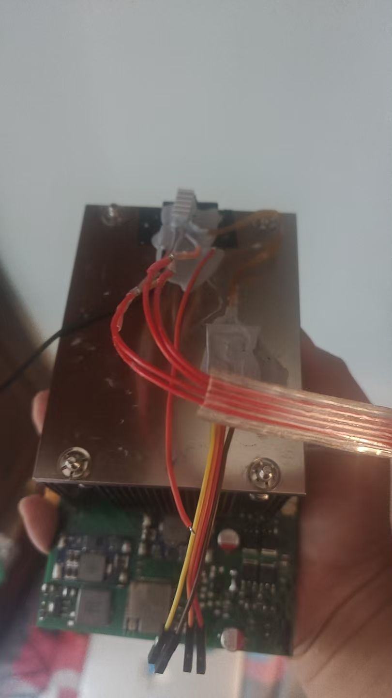
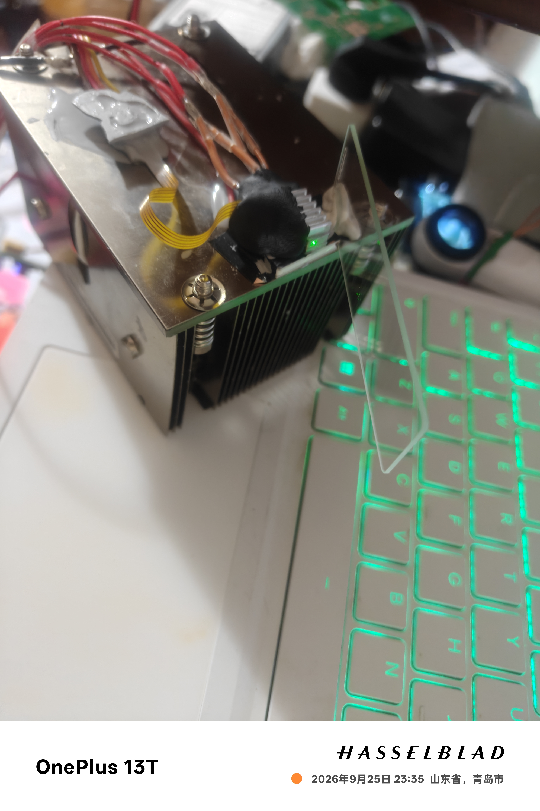
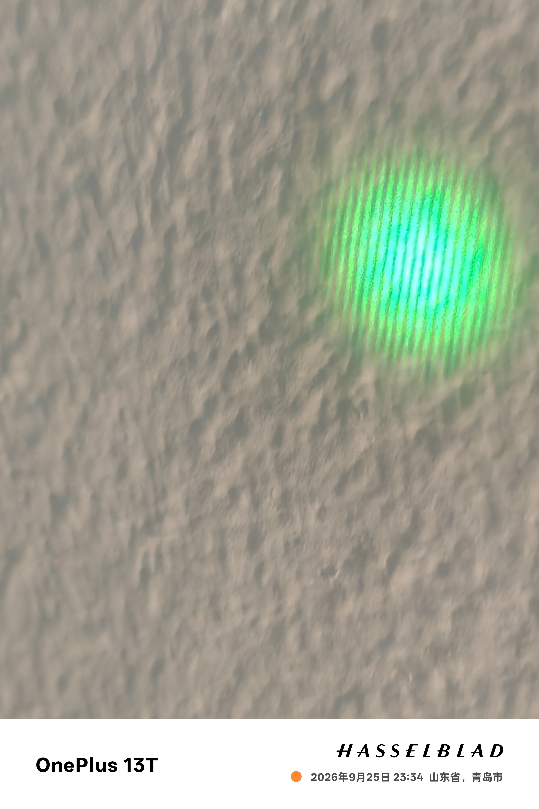

# 硬件与实测

## 引脚与接线

控制板采用 ESP32-S3-WROOM-1-N8R8、TMP117 和 DRV8701P 外置 H 桥，PCB 工程位于 `hardware/PL530.epro2`。下表对照的是手头 `Kit_2/PCB3_2` 的接线记录，焊接和接线前请对照手里的 PCB 丝印和工程文件再核对一次。

| 信号 | ESP32-S3 GPIO | 模组物理引脚 | 对端 |
|---|---|---|---|
| PWM IN1 | GPIO4 | 4 | DRV8701P 引脚 15 |
| PWM IN2 | GPIO5 | 5 | DRV8701P 引脚 14 |
| nSLEEP | GPIO6 | 6 | DRV8701P 引脚 13 |
| nFAULT | GPIO7 | 7 | DRV8701P 引脚 9 |
| SDA | GPIO8 | 12 | TMP117 SDA |
| SCL | GPIO9 | 17 | TMP117 SCL |
| UART RX | GPIO44 | 36 | 下载器 TXD |
| UART TX | GPIO43 | 37 | 下载器 RXD |
| BOOT | GPIO0 | 27 | BOOT 按键 |
| EN | 非 GPIO | 3 | 复位按键 |

注意模组的物理引脚号和 GPIO 编号并不相等。GPIO8/9 的 SDA/SCL 顺序软件上电会自动试探。TMP117 四针座在原板上按 `VCC / SCL / SDA / GND` 排列，3.3 V 供电、默认地址 `0x48`，插头接上去前先看清线序，顺便检查主板外部 I2C 上拉电阻有没有贴好。

## 电源与功率回路

DRV8701 的 `VM` 接 `12V_SYS`，H 桥高侧 MOS 漏极接独立低压 TEC 母线，低侧经检流电阻回地。**DRV8701 吃 12 V，TEC H 桥吃独立低压电源，两路共地——千万别把 TEC 直接接到 12 V 上。**

我用的 TEC 原始规格是 04903（额定 5 V / 3 A）。独立 DC-DC 可以按你手里 TEC 的规格、工作电流和散热条件设成 **3.3 V 或 5 V**；改了母线电压后重新测一次热响应和方向检测。

母线电压全靠外置 DC-DC 手调，调好拿万用表量准再接入。固件不会读取也不会去调这个电压（串口旧日志里的电压文字不是实际测量值）。

分供电的时候注意核对 `IDRIVE` 和芯片自身 `AVDD` 的连接。DRV8701 内部的 `AVDD`、`DVDD` 是输出引脚，不能跟外部电源并接；电荷泵电容按手册节点跨接。

板子上的 `SO` 只拉出来做了个测试点，没有接进 ESP32 的 ADC，所以网页看不到电流，软件也不管电流闭环。限流保护由外部电源或保护器件负责。

## 恒压与恒流模块

### MINI560 恒压与调压

恒压支路用的是 **MINI560 降压模块**，我把反馈分压网络里的一颗定值电阻拆掉，换成了合适阻值的电位器来手动调压。

样机省事直接拿双面胶把电位器粘在模块电感顶部。照着改的话记得做好引脚和飞线绝缘、选耐温胶带，周围留点散热空隙。不同批次 MINI560 反馈网络和电阻位号可能不一样，买回来先对照测量再动烙铁。**调压时务必先断开后级负载，用万用表确认好电压再接回主控板，免得过压烧片子。**

这一路 MINI560 调成 3.3 V 或 5 V 后专供 **TEC H 桥的独立低压母线**，跟 DRV8701 的 12 V `VM` 和 ESP32 的 3.3 V 逻辑电分开。

### LM2596 恒流方案与电容

恒流支路用的是 **基于 LM2596 的恒流模块**（选型时确认模块带电流采样和恒流反馈环路，别买成纯降压版）。

样机目前为了控制采购成本先沿用了模块自带电容，额外的滤波与就近旁路电容还没全补齐，后面打算按实际带载继续补强。补电容时记得看耐压、纹波电流和 ESR，LM2596 对输出电容 ESR 有明确要求，具体看 TI《LM2596 数据手册》（SNVS124G）。

## 样机实拍与散热

样机压了一块 **服务器散热器** 给热端散热，实际装机按自己的空间、热负载和风道挑散热器就行。下面几张图是搭好后的装配和干涉条纹实验实拍：

### 温控样机整体

### 服务器散热器装配

### 干涉条纹测试

## 实测表现

原版样机已经跑完了连续 **30 分钟烤机测试**：

| 测试项 | 实测情况 |
|---|---|
| 连续运行 | 30 分钟烤机，整体运行稳定 |
| 纵模状态 | 全程维持单纵模，没有跳模 |
| 输出功率 | 功率稳得住，没有明显漂移 |

更早的台架调通记录还包括成功烧录、TMP117 正常读温，以及反向 50% PWM 下把温度从约 31.45 °C 拉到 30.92 °C。软件回归和编译结果见 [发布验证](发布验证.md)。

## 复刻与踩坑提醒

- **PCB 工程说明**：这块板子画的时候用了 AI 辅助生成和自动布线，之前导出检查留了 16 条模块间距告警和 1 条原生网表差异提示；整理仓库时直接打包了原始 `PL530.epro2`，没有重新跑 ERC/DRC。我自己打样焊接跑通了，但复刻或改板前建议自己过一遍网表、大电流功率回路、线距载流和散热，再跑一次 ERC/DRC。
- **首次上电**：推荐先用带限流的台式电源试机，盯一下各路电压、电流、MOS 栅极波形和器件温升，确认散热器装紧压实。最好再串一个能直接断掉功率供电的物理开关。
- **探头位置**：TMP117 测的是它自己贴装处的温度，装机时尽量贴近激光器被控温点。
- **踩过的坑（C2 虚焊与 nFAULT）**：我最早焊接调试时碰到过一次 DRV8701 电荷泵 `C2` 虚焊，补焊好后 `VCP` 才拉回约 21.5 V；早期测试也有过正向输出触发 `nFAULT` 的情况。上板遇到 `nFAULT` 拉低，直接断电检查芯片焊接、电荷泵电容、供电和功率回路后再测。如果开着调试固件里的强制唤醒，它会绕过部分停机保护，具体行为见 [调试接口](调试接口.md)。
