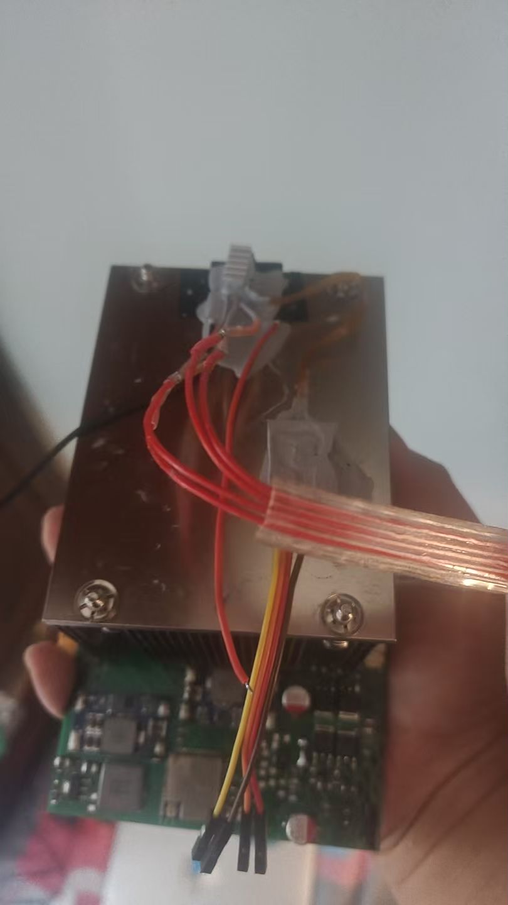
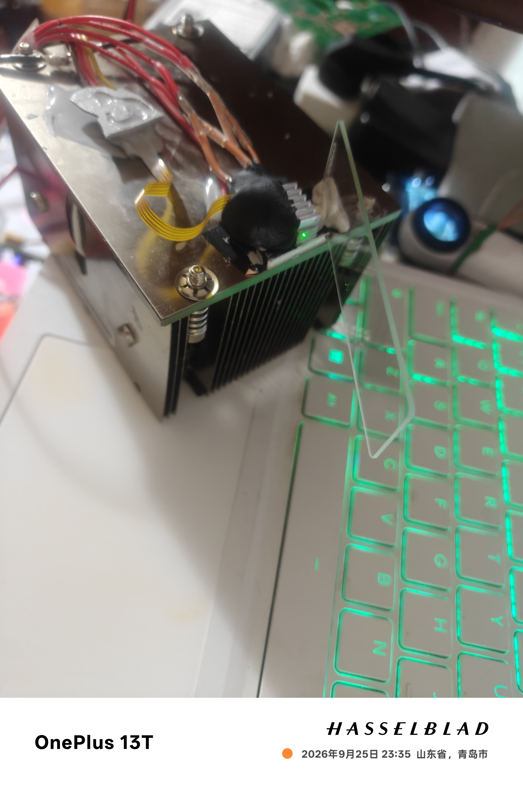

# 硬件与风险

## 硬件说明

固件引脚配置来源于原项目的 Kit_2/PCB3_2 记录。仓库中的 `hardware/PL530.epro2` 为用户当前指定文件；本次未将其全部铜层、网表、器件值与这些历史记录重新逐项比对。**接线表是固件接口说明，不是当前 PCB 的完整电气验收。实物与原生工程应独立核对。**

| 信号 | ESP32-S3 GPIO | 模组物理引脚 | 对端 |
|---|---|---|---|
| PWM IN1 | GPIO4 | 4 | DRV8701P 引脚 15 |
| PWM IN2 | GPIO5 | 5 | DRV8701P 引脚 14 |
| nSLEEP | GPIO6 | 6 | DRV8701P 引脚 13 |
| nFAULT | GPIO7 | 7 | DRV8701P 引脚 9 |
| SDA | GPIO8 | 12 | TMP117 SDA |
| SCL | GPIO9 | 17 | TMP117 SCL |
| UART RX | GPIO44 | 36 | 下载器 TXD |
| UART TX | GPIO43 | 37 | 下载器 RXD |
| BOOT | GPIO0 | 27 | BOOT 按键 |
| EN | 非 GPIO | 3 | 复位按键 |

模组的物理引脚号与 GPIO 号不是同一编号。GPIO8/9 顺序可以由固件探测，但电源、地、地址和上拉不能靠软件修复。

历史 TMP117 四针接口顺序为 `VCC / SCL / SDA / GND`，使用 3.3 V、地址 `0x48`。确认实物插座方向，不要凭左右位置猜针序；主板 I2C 上拉需核对是否实际装配。软件的弱内部上拉与低速通信不替代可靠的外部上拉设计。

## 电源与功率回路

历史方案为 DRV8701 的 `VM=12V_SYS`，独立低压 TEC 母线接高侧 MOS 漏极，低侧经检流电阻回地。DRV 的供电与 TEC 母线不是同一电源，必须共地，不能将 TEC 接到 12 V。

TEC 原始规格为 04903、额定 5 V/3 A。为 TEC H 桥供电的独立 DC-DC 可选择 **3.3 V 或 5 V**；两种电压均属于本项目的供电选择，但应按实际 TEC 规格、工作电流、散热条件和电源带载能力确认。更换电压后需重新检查热响应与方向检测，不能把两种工况视为完全等效。

实际母线电压取决于 DC-DC 调整和实物，固件不能读出或设定该电压。禁止根据串口中“3.3 V”等历史文字推断实测输出。

历史分供电设计要求核对 `IDRIVE` 与自身 `AVDD` 的连接。DRV 的 `AVDD`、`DVDD` 是芯片内部输出，不能与外部 3.3 V 或 5 V 电源并接。电荷泵电容跨接节点也不能按普通对地旁路接法处理。

`SO` 在历史板上仅到测试点，未接 ESP32 ADC。网页显示电流不可用，固件没有电流闭环，也不能代替电源限流或外置保险丝。

## 恒压与恒流模块

### MINI560 恒压与调压

本项目的恒压支路使用 **MINI560 降压模块**。样机通过将反馈分压网络中的一只固定电阻替换为合适阻值范围的电位器，实现输出电压调节，而不是由 ESP32 或网页控制输出电压。

改装后的电位器可用双面胶固定在模块的电感顶部，作为样机的简易安装方式。需保证电位器引脚及接线绝缘、固定可靠，并核对胶材耐温与电感温升，避免松脱、短路或妨碍散热；这不代表该固定方式已经通过长期可靠性验证。

不同批次 MINI560 的芯片、反馈电阻和布局可能不同。本仓库不指定通用电阻位号或电位器阻值，应按实际模块核对反馈网络，避免调节或接触不良导致输出过压。改装和调整前先断开负载，设定并测量输出电压后再接入电路。

TEC 的 MINI560 模块可设置为 3.3 V 或 5 V。这里指的是 **TEC H 桥的独立低压母线**，不是 DRV8701 的 12 V VM，也不是 ESP32 的 3.3 V 逻辑电源轨。

### LM2596 恒流方案与电容

恒流支路使用 **基于 LM2596 的恒流模块方案**。恒流能力取决于模块额外的电流采样与反馈电路，不能把普通 LM2596 恒压降压板直接当作恒流源。

输入、输出滤波及就近旁路电容仍应按实际模块和负载条件补充、核对。当前样机受电容采购成本影响，额外电容补强暂未全部落实，属于待完善项，**不是说明这些电容在电气上不需要，也不是建议拆除模块原有的必要电容。**

补电容不应只追求更大容量。应同时考虑耐压、纹波电流、ESR、布局及控制环路稳定性，并测量输出纹波和负载变化时的响应。尤其不能未经核对就把 LM2596 输出电容全部替换为低 ESR 陶瓷电容；可参考 TI《LM2596 数据手册》（SNVS124G）的电容选型说明。

### 购买渠道

硬件部分没有器件或模块赞助商，因此本项目不提供购买链接、店铺推荐或代购方式。文中型号仅用于说明当前样机方案，不构成对某个商家、批次或模块质量的背书；已有 GPT 模型服务渠道致谢与硬件采购无关。

## 样机实拍与散热

当前样机使用 **服务器散热器** 作为散热组件，照片展示实际装配、控制板和接线状态。服务器散热器的具体型号未在本仓库中限定；没有散热器或其他硬件赞助商，因此不提供购买链接、店铺推荐或代购方式。

以下照片由项目作者提供，按内容重新命名，保留原图画面。照片用于记录样机外观，不代表散热能力、温控精度、电气安全或长期可靠性已经完成验收。

### 温控样机整体

整体照片展示服务器散热器、控制板与外部接线的装配关系。图中的临时接线和固定方式属于样机状态，不应直接当作最终装配规范。

### 服务器散热器装配

近照记录散热器、固定件和周边接线。照片不能证明散热接触、绝缘或工作温升符合要求，复刻时仍需按实际结构独立检查。

### 绿色光斑记录

绿色光斑照片仅作现场记录，不能据其亮度、大小或相机曝光推断光功率，也不能作为温控效果的量化证据。

## 明确风险

- **AI 与自动布线：** 电路含 AI 生成、自动布线，可能有错接、断路、短路、载流不足、间距和接地问题。
- **历史 DRC：** 曾保留 16 项模块槽距问题及 1 项原生网表差异汇总提示；本次未复查指定工程，不能说这些问题已消失。
- **历史实物：** 电荷泵 C2 曾虚焊，补焊后记录 VCP 约 21.5 V；有另一方向触发 nFAULT 的记录，不能仅靠软件指定方向掩盖。
- **供电与温升：** 12 V 驱动器与低压桥分供时，栅极钳位、MOS 实际 VGS、驱动器温升、峰值电流和 DC-DC 过冲必须实测。
- **停止方式：** 网页停止、采样定时器和 MCU 都不是独立硬件急停。继承的驱动停机代码带有软件时序与实机专用分支，没有硬件级响应保证。
- **探头安装：** TMP117 测到的是其安装位置的温度，不自动代表 TEC 两面、功率器件或被控物温度。
- **调试模式：** 强制唤醒会绕过部分保护，可能在无温度反馈或驱动器故障时继续保持使能，详见调试文档。

## “实测可运行”的范围

用户确认硬件实测可运行。保留的现场记录也显示成功烧录、读温度，以及一组反向 50% PWM 测试中温度约从 31.45 °C 降至 30.92 °C。

同一批记录包含正向触发故障；它们不证明双向闭环、全负载、长期稳定性、保护有效性或量产一致性。本次整理不重新上板，新增发布改动也未重新完成实机验证。

复刻前请自行完成断电通断检查、原理图与 PCB 同步、ERC/DRC、限流上电、温度与电流记录、两向波形和实际硬件断电测试。发现 nFAULT 时先检查硬件，不能通过强制唤醒继续带故障运行。
